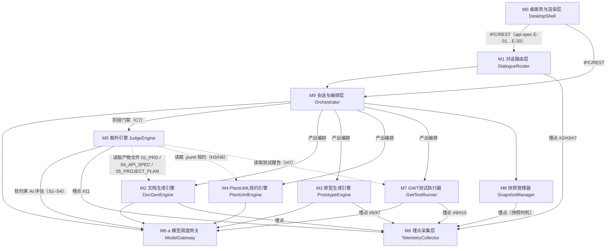

# 架构总览与技术选型（architecture.md）

> | 元数据 | 值 |
> |---|---|
> | 文档编号 | ARCH-01 | 隶属 | 03_ARCHITECTURE |
> | 版本 | v1.0 | 日期 | 2026-11-15 |
> | 产出角色 | 架构设计师 G3（向导Agent团队，长期迭代型·跳到前台） | 树节点 | t28a / t28a-W5-arch |
> | 需求锚点 | `01_PRD/prd.md` F-01…F-24 + §6 NFR-01…NFR-05 | 需求源 | `inputs/prd-v0.2-source.md` §13（技术架构概述） |
> | 辅助输入 | `00_AGENT_ROLES.md`（角色→运行时组件）、`02_UX_DESIGN/sitemap.md` + `user-flows.md`（页面与旅程→模块边界） |
> | 下游对账 | `04_API_SPEC/api-spec.md`（端点 E-01…E-30）、`class-diagram.puml`、`sequence-diagrams/*.puml`、`data-model.md`；W6（05_PROJECT_PLAN）、W7（整合） |

---

## 1. 架构目标与设计约束

| # | 约束 | 来源 | 架构应对 |
|---|------|------|---------|
| C1 | 能用文件就别用数据库，能用内存就别用 Redis，能用函数调用就别用消息队列 | 需求源 §13.3 原则 | 零数据库、零中间件：一切状态 = 项目目录内文件（§4.4、`data-model.md`） |
| C2 | 编程Agent在用户**本地**运行；项目源码/用户内容不上传 | NFR-01 | 本地执行沙箱（宿主进程内子进程），全离线可运行 |
| C3 | 各 Agent 角色绑定独立 System Prompt + 模型配置；视觉/长上下文分模型 | NFR-03、需求源 §13.2 | ModelGateway 按角色路由模型（§3.3） |
| C4 | 用户只面对一个"向导"，角色静默切换 | F-09 | DialogueRouter 单出口 + 阶段角色路由（§4 M1） |
| C5 | 操作 >5 秒显示进度安抚文案；报错永不以技术堆栈呈现 | F-19、NFR-04 | 引擎层产出结构化"文案位"，壳层只渲染文案（§4 M0/M1） |
| C6 | 文档双标准：机器可解析 + 人可阅读 | NFR-05、需求源 §5.1 | 文档生成引擎统一产出"结构化 front-matter + 生活化正文"格式 |
| C7 | 文档/代码不经裁判通过，不能进入下一阶段 | 需求源 §9.1 | Orchestrator 状态机上，每个阶段迁移前置 JudgeEngine 门禁调用（§4 M5） |
| C8 | 快照只做线性回滚、不做分支；用户不可手动建快照 | F-08 | SnapshotManager 单链时间轴模型（§4 M8） |

## 2. 总体架构（分层视图）

```
┌─────────────────────────────────────────────────────────────────────┐
│ L0 宿主层  Electron 桌面壳                                           │
│   Renderer（P0–P6 用户前台页 + R1–R5 研究区） ←IPC/REST→ Main Process │
├─────────────────────────────────────────────────────────────────────┤
│ L1 用户交互层  M1 对话路由层 DialogueRouter                           │
│   （单一向导出口 · 阶段角色路由 · 心理防御文案播报）                    │
├─────────────────────────────────────────────────────────────────────┤
│ L2 编排层  M9 会话与编排层 Orchestrator                               │
│   ├─ M9·a 模型调度网关 ModelGateway（角色→模型绑定、并发、Token记账）   │
│   ├─ M9·b 模板注册表与推断器 TemplateRegistry / TemplateInferrer      │
│   └─ M9·c 自愈循环 RepairLoop（≤3次修复 → 熔断）                      │
├─────────────────────────────────────────────────────────────────────┤
│ L3 生产引擎层                                                        │
│   M2 文档生成引擎 │ M3 原型生成引擎 │ M4 PlantUML规约引擎 │ M7 GWT测试执行器 │
├─────────────────────────────────────────────────────────────────────┤
│ L4 门禁层  M5 裁判引擎 JudgeEngine（硬约束 H1–H8 + 软约束 S1–S4 + 调度）│
├─────────────────────────────────────────────────────────────────────┤
│ L5 横切层  M6 埋点采集层 TelemetryCollector │ M8 快照管理器 SnapshotManager │
├─────────────────────────────────────────────────────────────────────┤
│ 存储介质（本地文件系统，唯一持久化）                                   │
│   projects/{id}/…（文档体系+索引） · roles/ · templates/ · snapshots/ │
└─────────────────────────────────────────────────────────────────────┘
```

**进程模型**：Electron Main Process 承载 L1–L5 全部运行时（单进程内函数调用，无消息队列）；Renderer 只做渲染与交互；预览静态服务（127.0.0.1 随机端口，仅本机回环）为原型 iframe 提供资源；编程Agent的本地工具链执行（构建/测试命令）运行在受控子进程中，工作目录限定在项目目录白名单内。

**Agent 间交接介质**：向导团队 ⇄ 编程团队、引擎 ⇄ 引擎之间一律以**项目目录中的文件产物**交接（PRD §5.1"文档即约定"）：`.md`（PRD/架构/计划）、`.prototype.html`（原型）、`.puml`(规约)、`.feature`（GWT）、`.json`（索引与判定）、`.jsonl`（追加流）。引擎之间**不直接互相调用**，由 L2 Orchestrator 编排并读写文件（§5）。

## 3. 技术选型及理由（裁判硬约束 H2-①）

### 3.1 桌面壳：Electron vs Tauri

| 维度 | Electron ✅（选定） | Tauri（备选） |
|------|--------------------|--------------|
| 与 Proma 上游的同构性 | Proma 为 Web/Node 技术栈，fork 后几乎零改造即可桌面化 | 需将宿主侧逻辑用 Rust 重写或以 sidecar 外挂，fork 偏离大 |
| 编程Agent本地执行 | Main Process 原生 Node：child_process、文件监听、npm/脚本生态直接可用 | 需随应用分发独立 Node sidecar，体积与维护成本上升 |
| 三平台一致性 | Win/macOS/Linux 一套代码 | 同样支持，但 Rust 工具链引入平台差异面 |
| 安装体积/内存 | 劣势（~150MB 起，内存占用高） | 优势（~10MB 级，内存低） |
| 安全模型 | 需自行收敛（contextIsolation + 白名单 IPC） | 默认更严格 |
| 渲染引擎一致性 | 内置 Chromium，原型预览与用户浏览器行为一致性可控 | 依赖系统 WebView，三平台渲染差异需额外验证 |

**结论（ADR-01）**：v1 选 **Electron**。决定性理由是 ①Proma fork 成本与上游合并成本最低（同栈）；②编程Agent本地执行天然依赖 Node 工具链；③原型预览与 Chromium 行为一致（PRD §7.2 前端Agent以原型 HTML 为实现模板）。Tauri 的体积/内存优势记为 **Phase 4 后的评估项**（ADR-01 附录），届时若迁移，L1–L5 运行时层因与壳层仅通过 IPC/REST 通信（§4 通用约定）而可整体平移。

### 3.2 Proma fork 边界

| 类别 | 内容 | 说明 |
|------|------|------|
| 保留 | 会话 UI 框架、消息流组件、多模型 API 适配基础（OpenAI 兼容协议骨架）、i18n/主题 | Proma 原有能力直接复用 |
| 替换 | 存储层：禁用其数据库写路径，会话/项目状态改写为文件体系（C1） | 对话轮次落 `sessions/*.jsonl` |
| 替换 | 对话路由：单一聊天 → 阶段化角色路由（M1） | 支撑 F-09 |
| 新增 | M1–M9 九个模块（§4），集中在新目录 `src/platform/` | 与上游代码物理隔离 |
| 裁剪 | 云同步、多用户协作、分享/评论等与本产品无关特性 | 缩小攻击面与维护面 |

**上游合并策略**：fork 分支 `vendor/proma` 跟踪上游；本平台改造全部收敛在 `src/platform/` 与少量"接缝 patch"，定期 rebase，保证冲突面最小。

### 3.3 模型调度层（ModelGateway，M9·a）

角色 → 模型绑定（对齐 NFR-03 与需求源 §4.3 模型策略列）：

| Agent 角色 | 模型策略 | 绑定理由 |
|-----------|---------|---------|
| 需求分析师 G1 | 对话能力强、有耐心的对话模型 | 多轮引导、生活化复述（F-02） |
| UI/UX顾问 G2 | 带视觉能力的国产多模态模型 | 原型生成 + 截图审查 + 点选纠错理解（F-05/F-06/F-07） |
| 架构设计师 G3 | 逻辑推理强、长上下文 SOTA | PlantUML 建模、API 规范、全局把控（本文档产出者） |
| 工程经理 G4 | 长上下文 SOTA、软工方法论 | 团队配置/Sprint 规划（W6 角色） |
| 编程各角色 P1–P8 | 代码模型为主；架构师角色用长上下文 | 编码/审查/测试步骤定义 |
| 裁判引擎内部评估 | 独立配置的强推理模型 | 软约束 S1–S4 评估（F-17） |

**网关职责**：并发调用（需求分析师 ∥ UI/UX顾问，C1 协作关系）；每角色独立 System Prompt 文件（`roles/{roleKey}.prompt.md`）；超时与重试策略；**>5 秒即发进度事件**（NFR-04 的信号源）；逐调用 Token 记账喂给 M6（需求源 §12.3 Token 经济层）；模型不可用时的降级提示（仍走 F-19 文案，不暴露技术错误）。

### 3.4 本地文件系统作为 Agent 间交接介质

对齐需求源 §13.1"Agent间通过文件系统（项目目录）交接，不使用消息队列等重量级中间件"：

- **项目目录即契约**：向导团队交付的是完整目录结构（PRD §5.2），编程团队消费同一目录；裁判引擎校验的也是同一目录中的文件。
- **内容文件 vs 索引文件**：内容一律人可读格式（Markdown/HTML/puml/feature）；机器可解析的元数据（状态、判定、快照序列、埋点）用 JSON / JSONL 索引，**索引可随时从内容文件重建**（`data-model.md` §3.4）。
- **一致性协议**：所有文件写入 = 写临时文件 + 原子重命名；追加流（轮次、埋点）用 JSONL append；快照恢复 = 目录级原子替换。
- **不引入**：数据库（连 SQLite 也不用于平台自身状态）、Redis、消息队列、微服务。

### 3.5 其他选型

| 领域 | 选型 | 理由 |
|------|------|------|
| 语言 | TypeScript（全栈同语言） | 与 Proma 上游一致；引擎接口类型化 |
| UI 框架 | React（继承 Proma） | 上游复用 |
| PlantUML 处理 | 自研轻量文本解析器（AST 校验 + 结构提取），**不渲染图片** | 需求源 §8.4：产出 `.puml` 代码文件而非图片，裁判直接解析文本 |
| GWT 执行 | 内置 runner 解析 `06_TESTS/features/*.feature`（Given/When/Then 步骤映射到可执行断言） | 快消/长期统一收口机制（F-15） |
| 本地执行沙箱 | child_process + 项目目录白名单 + 命令模板白名单 | NFR-01 本地运行的安全边界 |
| 打包分发 | electron-builder 三平台产物 | — |

## 4. 模块划分（裁判硬约束 H2-②）

覆盖需求源 §13.3 全部八模块，并补充**会话与编排层**（M9）与宿主层（M0）。关键类名与 `class-diagram.puml` 一致。

### M0 桌面壳与渲染层（DesktopShell）

- **职责**：渲染 P0–P6 用户前台页与 R1–R5 研究区（`sitemap.md`）；IPC/REST 客户端；进度提示条 / 快照提示条 / 安抚文案的**纯渲染**（文案内容由引擎给出，壳层不改写）。
- **对用户隐藏**：源码、PlantUML、GWT 文件、角色切换过程、技术配置面板（`sitemap.md` §8 可见性规则）。
- **负责 F-xx**：呈现端协同（F-19 呈现、F-21 看板 UI）。

### M1 对话路由层（DialogueRouter）——§13.3「对话路由层」

- **职责**：判断当前阶段（SessionStage 状态机），按规则加载对应角色 System Prompt；对用户**单一出口**；维护"已确认需求清单"（F-02）；心理防御文案播报（F-19 五类文案逐字使用）。
- **关键方法**：`submitRound()`、`route(stage): AgentRole`、`switchRole()`、`broadcastCopy()`。
- **输入/输出文件**：读 `roles/index.json` 与 `roles/{roleKey}.prompt.md`；读写 `sessions/{sessionId}.jsonl`、`requirements.json`。
- **负责 F-xx（主）**：F-01、F-02、F-09、F-19；（协）F-14（对话关键词供给推断器）。

### M2 文档生成引擎（DocGenEngine）——§13.3「文档生成引擎」

- **职责**：产出标准化 PRD / 用户故事 / 架构文档 / GWT Feature / changelog；统一满足 NFR-05 双标准（结构化 front-matter + 零基础可读正文）。
- **关键方法**：`generatePrd()`、`generateUserStories()`、`generateGwt(): GwtScenario[]`（PRD 定稿后逐 F-xx 生成正常+边界+异常场景）、`appendChangelog()`。
- **输出文件**：`01_PRD/*`、`06_TESTS/features/*.feature`、`07_VERSIONS/changelog.md`。
- **负责 F-xx（主）**：F-03、F-04、F-15（场景生成侧）；（协）F-22、F-23（交接文档载体）。

### M3 原型生成引擎（PrototypeEngine）——§13.3「原型生成引擎」

- **职责**：生成带内联 CSS/JS 的**单文件 HTML 原型**（模拟数据、可点击跳转）；调用视觉模型自查布局/可用性；捕获点选纠错目标（selector + 上下文）；修改后重建并刷新预览；Figma 素材导入（远期）。
- **关键方法**：`generatePrototype()`、`reviewByVision()`、`captureClickTarget()`、`refreshPreview()`。
- **输出文件**：`02_UX_DESIGN/wireframes/*.prototype.html`（预览静态服务对外暴露）。
- **负责 F-xx（主）**：F-05、F-06、F-07（捕获侧）、F-24。

### M4 PlantUML 规约引擎（PlantUmlEngine）——§13.3「PlantUML规约引擎」

- **职责**：产出 `.puml` 类图/时序图规约文件；**语法有效性校验**（裁判硬约束 H3 的执行者）；从 `.puml` 提取类结构/调用序列供裁判做 H8 结构一致性比对。
- **关键方法**：`generateClassDiagram()`、`generateSequenceDiagram()`、`validate(): SyntaxReport`、`extractStructure()`。
- **输出文件**：`03_ARCHITECTURE/class-diagram.puml`、`03_ARCHITECTURE/sequence-diagrams/*.puml`。
- **负责 F-xx（主）**：F-11（PlantUML 主约束）；（协）F-16（H3 校验支撑）。

### M5 裁判引擎（JudgeEngine）——§13.3「裁判引擎」

- **职责**：①硬约束规则执行（H1–H8，需求源 §9.2 表逐项，不可通融，不通过直接退回）；②软约束 AI 评估（S1–S4 四维，通过/建议改进/退回三档）；③**调度控制**（§9.4 兼职调度Agent：按工作包调度编程角色流水线）。模式差异：快消型核心项 + 退回 2 次上限；长期型全量 H1–H8、不限次必须通过（§9.3）。
- **关键方法**：`hardCheck(artifact): JudgeVerdict`、`softEvaluate(artifact): JudgeVerdict`、`dispatchWorkPackage()`。
- **输入文件**：`01_PRD/*`、`03_ARCHITECTURE/*`、`04_API_SPEC/*`、`05_PROJECT_PLAN/*`、`06_TESTS/*`、测试报告 JSON、代码结构提取结果。
- **负责 F-xx（主）**：F-16、F-17；（协）F-10/F-11（阶段门禁）、F-13（调度）、F-15（收口判定）。

### M6 埋点采集层（TelemetryCollector）——§13.3「埋点采集层」

- **职责**：全量、无侵入、静默采集需求源 §12.4 十三类事件（TraceEventType 枚举一一对应）；payload 脱敏（科研导出不含真实业务内容，NFR-01）；30 天保留 + 手动删除（NFR-02）；脱敏导出供研究看板（F-21）。
- **关键方法**：`track(type, payload)`、`anonymize()`、`export()`。
- **输出文件**：`projects/{id}/trace/events-*.jsonl`（append-only）、`research/export/*.jsonl`（脱敏）。
- **负责 F-xx（主）**：F-20、F-21。

### M7 GWT 测试执行器（GwtTestRunner）——§13.3「GWT测试执行器」

- **职责**：运行 GWT 场景（全量或回归子集），产出结构化测试报告（通过率、逐场景结果）；失败信号喂给自愈循环（M9·c）与裁判收口。
- **关键方法**：`runAll(): TestReport`、`runScenarios(ids): TestReport`。
- **输入/输出文件**：`06_TESTS/features/*.feature` + 步骤定义；`test-reports/{reportId}.json`。
- **负责 F-xx（主）**：F-15（执行侧）；（协）F-11（Sprint 收口）、F-18（失败检测）。

### M8 快照管理器（SnapshotManager）——§13.3「快照管理器」

- **职责**：四类时机**自动**快照（初版生成 / 用户确认修改前后 / 模式转换 / 异常回滚前，F-08）；线性单链时间轴（无分支概念，回滚后旧快照转"存档"）；一键回滚（当前版本先存再恢复，原子替换）；用户无手动建快照入口。
- **关键方法**：`autoSnapshot(trigger, desc): Snapshot`、`listSnapshots()`、`rollbackTo(id): Snapshot`。
- **输出文件**：`snapshots/index.json`（线性序列）、`snapshots/{snapshotId}/`（项目文件树拷贝）。
- **负责 F-xx（主）**：F-08；（协）F-07（大改前）、F-12（转换前后各一份）、F-18（熔断回滚执行者）。

### M9 会话与编排层（Orchestrator）——**补充模块**（§13.3 之外新增）

- **职责**：①会话/项目状态机（SessionStage：MODE_GATE→REQUIREMENTS→PROTOTYPE→ARCHITECTURE→PLANNING→CODING→TESTING→DELIVERY），每次阶段迁移前调用 M5 门禁（C7）；②Agent 团队生命周期与任务编排（向导 4 角色路由 + 编程 8 角色池激活，F-13）；③**ModelGateway**（M9·a，§3.3）；④**TemplateRegistry/TemplateInferrer**（M9·b：六类模板注册、插件/JSON-YAML 导入、对话关键词推断，对用户不可见，F-14）；⑤**RepairLoop**（M9·c：失败自动修复 ≤3 次、策略可换、3 次失败熔断 → M8 回滚，F-18）；⑥Sprint 编排与版本推进（F-22）；⑦跨版本/跨会话上下文交接（F-23：新会话从项目文件体系恢复全部已确认结论，用户无需复述）。
- **关键方法**：`startProject()`、`advanceStage()`、`dispatch()`、`executeFixIntents()`、`handleFailure()`、`retryWithNewStrategy()`、`inferTemplate()`。
- **负责 F-xx（主）**：F-10、F-11、F-12、F-13、F-14、F-18（编排侧）、F-22、F-23；（协）F-19（文案调度）。

## 5. 模块依赖关系（裁判硬约束 H2-③）

### 5.1 运行时调用依赖图（Mermaid）



### 5.2 依赖说明表

| 依赖方 → 被依赖方 | 类型 | 说明 |
|------------------|------|------|
| M0 → M1/M9 | 调用（IPC/REST） | 壳层只经端点交互，不直连引擎（§6 与 `api-spec.md`） |
| M1 → M9 | 调用 | 阶段查询、角色注册表、编排请求 |
| M1/M2/M3/M7/M5/M8 → M6 | 调用 | 无侵入埋点：各模块只调 `track()`，不感知存储 |
| M9 → M2/M3/M4/M7/M8 | 调用 | 编排层是唯一"指挥"，引擎不互相调用 |
| M9 → M5 | 调用 | 每次阶段迁移/交付前的门禁调用 |
| M2/M3/M4/M7/M5 → M9·a(ModelGateway) | 调用 | 模型调用统一走网关（并发、记账、>5s 进度事件） |
| M5 ⇢ M2/M4/M7 | **文件交接**（虚线） | 裁判读取的是磁盘上的文档/规约/报告文件，不持有引擎引用（C1 原则的直接体现） |
| M3 ⇢ M2 | 文件交接 | 原型以 PRD 为输入；前端Agent以原型 HTML 为实现模板（C4 协作关系） |

**无环性说明**：M5→MG 与 M9→M5 不构成模块级环——MG 是 M9 的子组件（M9·a），图上独立成节点以表达"裁判的软约束评估也走统一模型网关"。除该子组件边外，调用依赖构成以 M9 为根的**有向无环图**；跨引擎协作一律走文件交接（虚线），与需求源 §13.1 原则一致。

## 6. F-xx → 模块映射总表（24 项全覆盖）

| F-xx | 功能 | 主责模块 | 协办模块 | 关键端点 |
|------|------|---------|---------|---------|
| F-01 | 启动两道门模式选择 | M1 | M9、M0 | E-01、E-03 |
| F-02 | 需求对话与多轮需求挖掘 | M1 | M9 | E-05、E-07 |
| F-03 | 精简PRD产出（快消型） | M2 | M1、M5 | E-09、E-10 |
| F-04 | 完整PRD与用户故事产出（长期型） | M2 | M5 | E-09、E-10 |
| F-05 | 可交互HTML原型生成 | M3 | M9、M0 | E-11、E-12 |
| F-06 | 原型视觉模型辅助审查 | M3 | M9·a | E-11 |
| F-07 | 点选纠错 | M3（捕获） | M9（编排）、M8（改前快照）、M7/M5（回归校验） | E-17…E-20 |
| F-08 | 时间轴自动快照与线性回滚 | M8 | M0（时间轴页） | E-21、E-22 |
| F-09 | 向导Agent角色切换与静默路由 | M1 | M9·a | E-05 |
| F-10 | 快消型自动化执行管线 | M9 | M5、M7、M2 | E-10、E-20 |
| F-11 | 长期迭代型规范化执行管线 | M9 | M4、M5、M2 | E-13…E-16 |
| F-12 | 模式转换（快消→长期升级） | M9 | M8（前后快照）、M2（补文档） | E-04 |
| F-13 | 编程Agent团队激活与协作 | M9 | M5（调度） | —（后台） |
| F-14 | 工程模板体系与自动推断 | M9·b | M1（关键词供给） | E-29、E-30 |
| F-15 | GWT测试场景生成与测试收口 | M2（生成）+ M7（执行） | M5（判定） | E-25、E-26 |
| F-16 | 裁判Agent硬约束门禁 | M5 | M9（门禁调用） | E-23、E-24 |
| F-17 | 裁判Agent软约束评估 | M5 | M9·a（评估模型） | E-24 |
| F-18 | 异常自愈与熔断回滚 | M9·c（RepairLoop） | M8（回滚）、M7（失败信号） | E-20、E-22 |
| F-19 | 心理防御文案与进度安抚 | M1（文案源） | M0（呈现）、M9·a（>5s 信号） | E-05、E-20 |
| F-20 | 全量埋点采集 | M6 | 全模块（track 调用方） | E-27 |
| F-21 | 后台分析看板与实验支持 | M6（数据） | M0（R1–R5 看板 UI） | E-28 |
| F-22 | Sprint规划与版本管理 | M9 | M2（changelog） | E-15、E-16 |
| F-23 | 跨版本与跨会话上下文交接 | M9 | M2（交接文档） | E-06 |
| F-24 | Figma设计稿导入（远期可选） | M3 | — | —（远期） |

**覆盖核对**：F-01…F-24 共 24 项全部有主责模块；NFR-01（M9·a 本地执行 + M6 脱敏）、NFR-02（M6 保留策略）、NFR-03（M9·a 绑定表）、NFR-04（M9·a 进度事件 + M0/M1 文案）、NFR-05（M2 双标准）均有落点。

## 7. 关键运行视图（与时序图互引）

| 时序图 | 覆盖旅程 | 主链路模块 |
|--------|---------|-----------|
| `sequence-diagrams/seq-01-requirements-to-prd-gate.puml` | UF-01/UF-02：需求对话→PRD定稿→裁判第一道关（含 F-09 角色静默切换） | M1→M9·a→M2→M5 |
| `sequence-diagrams/seq-02-sprint-code-gwt-merge.puml` | UF-03 成功主链：长期型 Sprint 内编码→GWT→裁判收口→合并 | M9→M7→M5→M8 |
| `sequence-diagrams/seq-03-click-to-fix.puml` | UF-04：预览点击→修改意图→编程Agent→自动刷新 | M3→M1→M9→M8 |
| `sequence-diagrams/seq-04-snapshot-rollback.puml` | UF-03/UF-05：熔断→回滚→安抚文案 | M9·c→M8→M1 |

## 8. 架构决策记录（ADR 摘要）

| ADR | 决策 | 关键理由 | 备选与放弃原因 |
|-----|------|---------|---------------|
| ADR-01 | 桌面壳选 Electron | Proma 同栈 fork、Node 工具链、Chromium 预览一致性 | Tauri：体积优势记为远期评估 |
| ADR-02 | 零数据库：文件体系为唯一持久化 | 需求源 §13.3 原则；项目目录本身即交付契约 | SQLite：对单机桌面应用属过度设计，且索引可重建 |
| ADR-03 | IPC + 本地 REST 混合接口 | IPC 保低延迟结构化通信；REST（127.0.0.1）服务预览静态资源、导出与对账 | 纯 IPC：预览 iframe/外部对账不便；纯 REST：多一跳且需端口管理 |
| ADR-04 | 快照线性单链 + 回滚前先存当前 | F-08 明确"不做分支"；回滚不丢当前版本 | Git 分支模型：引入用户无法理解的"分支"概念 |
| ADR-05 | 引擎间文件交接、编排层唯一指挥 | §13.1 文件交接；避免引擎网状调用 | 引擎互调：网状依赖难维护，且违背"文件即约定" |
| ADR-06 | 裁判只读文件做门禁，不做质量审计 | §9.1"流程门禁，不是质量审计员" | 深度代码审计：属编程团队 Reviewer 职责 |
| ADR-07 | 模型调用统一经 ModelGateway | NFR-03 角色绑定 + Token 记账（§12.3）+ >5s 进度信号集中一处 | 各引擎直连模型 API：记账/限流/降级逻辑重复 |

## 9. 裁判硬约束自检（需求源 §9.2 架构相关项对照）

| 硬约束项 | 本设计满足位置 |
|---------|---------------|
| 架构设计必须包含：技术选型及理由 | §3（3.1–3.5） |
| 架构设计必须包含：模块划分 | §4（M0–M9，覆盖 §13.3 八模块 + 会话与编排层） |
| 架构设计必须包含：模块依赖关系 | §5（Mermaid 依赖图 + 依赖说明表 + 无环性说明） |
| PlantUML 类图/时序图语法有效、类关系完整 | `class-diagram.puml`、`sequence-diagrams/*.puml`（4 张） |
| API 每端点 Method/Path/Request/Response Schema | `04_API_SPEC/api-spec.md` E-01…E-30 |

> 文档结束。下游：W6 工程经理基于 §4 模块边界与 §6 映射产出 `05_PROJECT_PLAN/`；W7 整合时以 §9 对照表验收。
